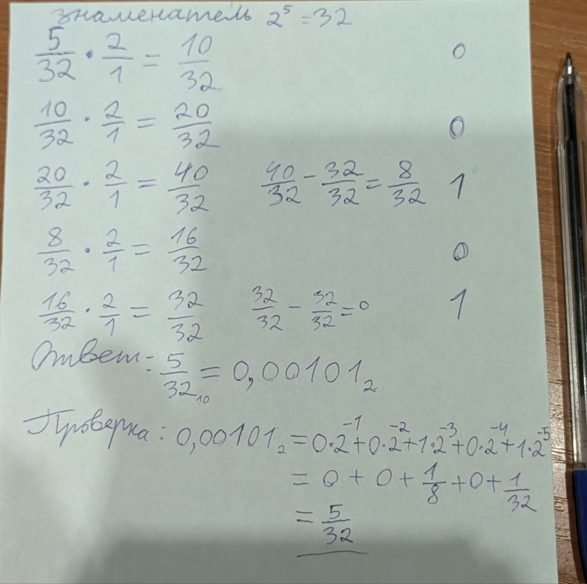
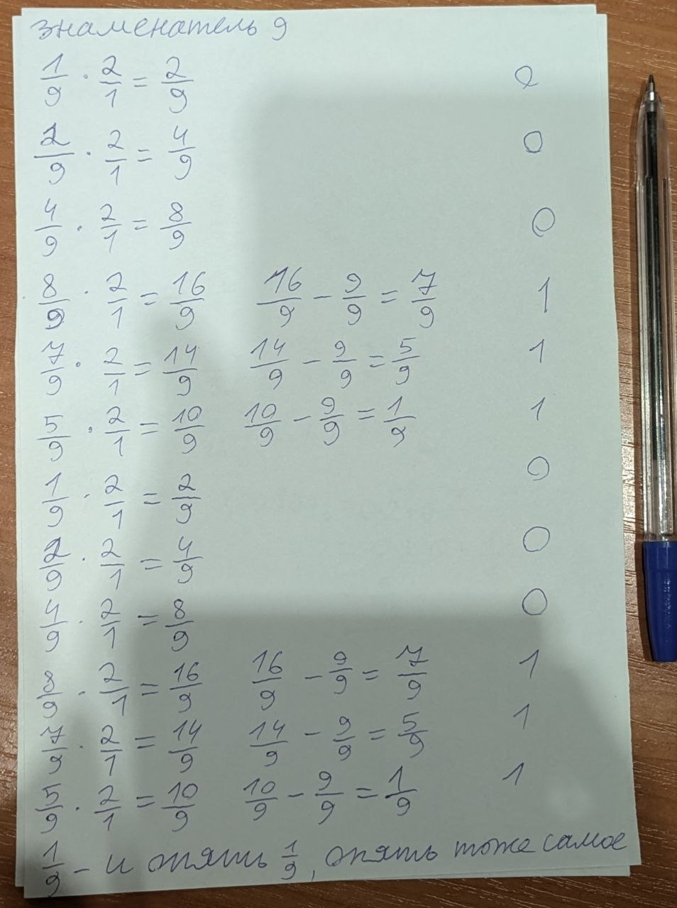
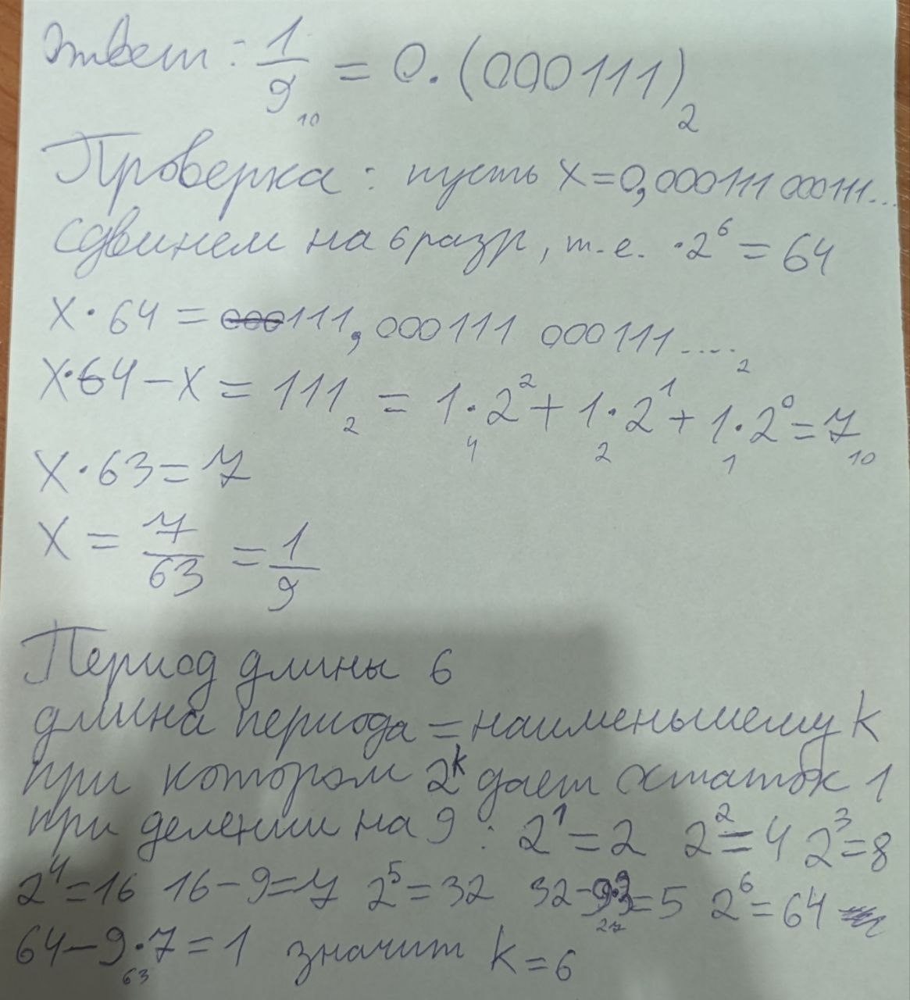
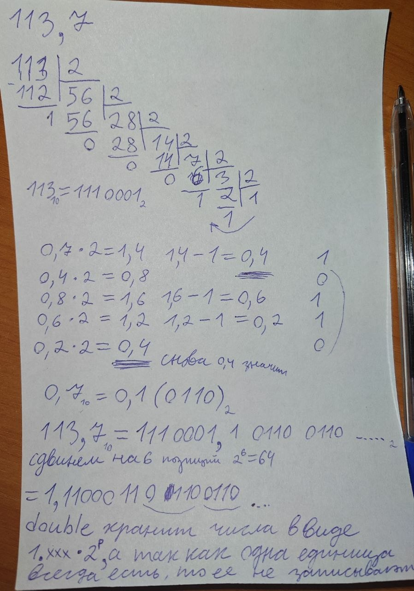
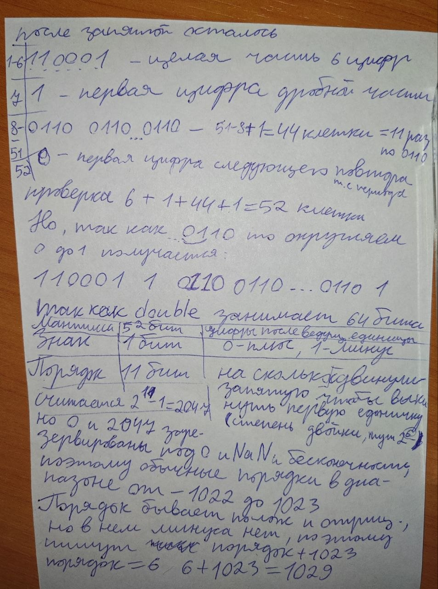
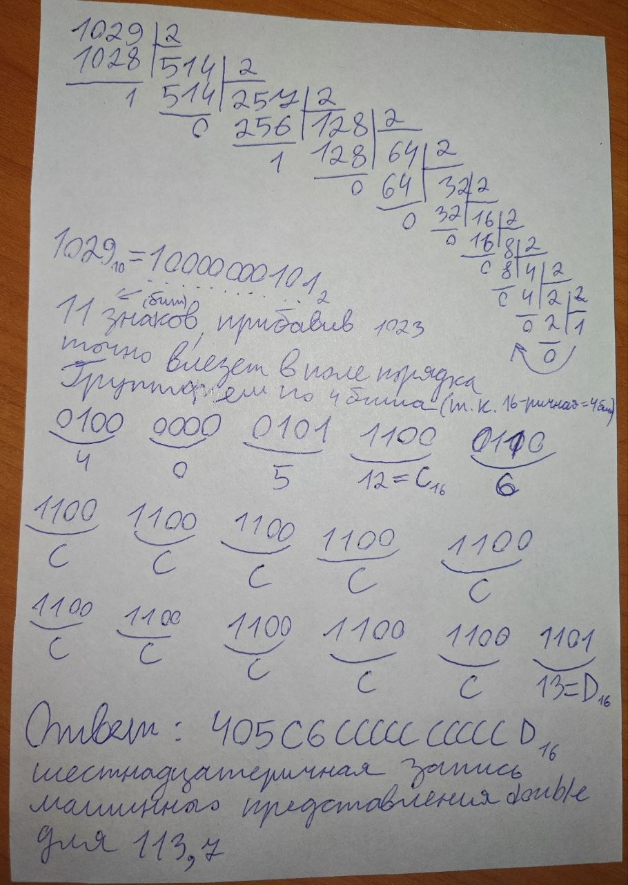
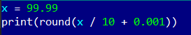
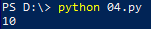

# Языки программирования
## Лабораторная работа 5

### Задание 1 **(2)**
*Переведите в двоичную запись два произвольных рациональных числа (числа вида* $\frac{p}{q}$).
*У одного из чисел знаменатель должен быть степенью двойки (32), а у другого --- некоторым числом
от 9 до 12.*

*Запись второго числа будет содержать период. Его надо найти. При решении задачи нельзя 
использовать вычислительную технику. Процесс решения должен быть представлен в отчете.*

---





---

### Задание 2 **(3)**
*Переведите в двоичную запись и найдите машинное представление в типе* **double**
*для произвольного вещественного числа большего, чем 100 с одним знаком после точки, например
для* $113.7$. *Цифра после точки не должна быть нулем иля пятеркой.*

*При решении задачи нельзя 
использовать вычислительную технику. Процесс решения должен быть представлен в отчете.*

---





---

### Задание 4 **(2)**

*Рассмотрим следующий пример в IDLE Python*
```
>>> x = 99.99
>>> int(x/10+0.001)
9
```
*Результат должен был быть равен 10, однако оказался другим. Почему так произошло?
Как исправить программу, чтобы она корректно переводила вещественные числа в целые?*

---

  


---

### Задание 6 **(2)**

*Для какого минимального значения* $n$ *программа на С++ выведет* **inf**? *Объясните
ответ.* *Что произойдет, если тип* **double** *заменить на* **long double**?
```
int n=...;
double s = pow(2, n);
std::cout << std::fixed << s << std::endl;
```

---

## Double занимает 64 бита 
- 1 бит знак
- 11 бит порядка 
- 52 бита мантиссы  
Порядок хранится 11 бит (максимум 11111111111 в двоичн. это 2047 в десятичн., но 11111111111 зарезервирован для inf, значит макс. допустимый порядок 11111111110 = 2046 в десятичн.) со смещением 1023 чтобы не выделять отдельные биты под отриц. степени  
Тогда максимальная степень двойки это n = 2026 - 1023 = 1023  
А если бы был n = 1024, то был бы 1024 + 1023 = 2047 что дает inf  

long double - это уже 80 бит, под порядок уже не 11 а 15 бит, смещение увеличивается с 1023 до 16383, мантисса увеличится с 52 до 63 или 64 бит (зависит от того какой компилятор какая реализация)

