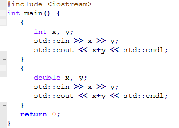
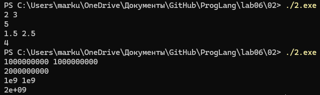
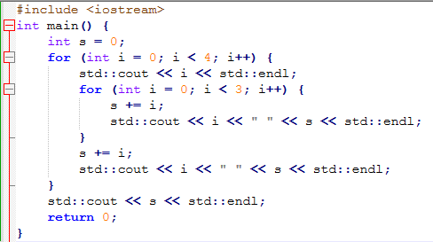
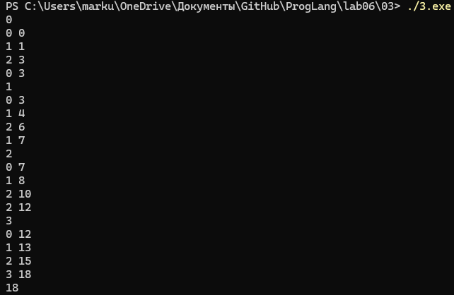
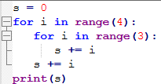
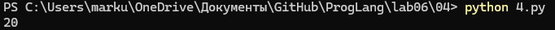
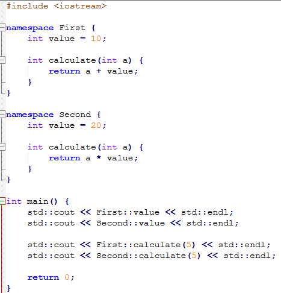
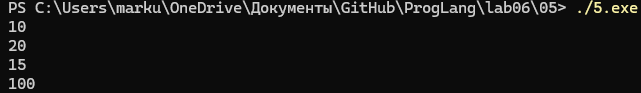

# Языки программирования
## Лабораторная работа 6

### Задание 2 **(2)**
*Проверьте работу следующей программы на С++*
```
#include <iostream>
int main() {
   {
      int x, y;
      std::cin >> x >> y;
      std::cout << x+y << std::endl;
   }
   {
      double x, y;
      std::cin >> x >> y;
      std::cout << x+y << std::endl;
   }
   return 0;
}
```
*Нужны ли в этой программе вложенные фигурные скобки? Дайте подробный ответ с объяснением причин.*
---
  
  
- Да, нужны, если убрать фигурные скобки, они создают область видимости - блок { }, то есть переменные объявлены внутри блока и уничтожаются на закрывающей скобке блока.  
- Иначе была бы они оба попали в область видимости main и там была бы ошибка из-за повторного объявления с другим типом.  
---

### Задание 3 **(2)**
*Проверьте работу следующего фрагмента программы на С++.*
```
int s = 0;
for (int i = 0; i < 4; i++) {
   for (int i = 0; i < 3; i++) {
      s += i;
   } 
   s += i; 
}
std::cout << s;
```
*В результате каких вычислений был получен ответ? Дайте подробный ответ.*
---
  
  
Первый цикл +3, второй +4, третий +5, четвертый +6, ответ 18.
---
### Задание 4 **(2)**

*Проверьте работу следующего фрагмента программы на* **Python**.
```
s = 0
for i in range(4):
   for i in range(3):
      s += i
   s += i
print(s)
```
*В результате каких вычислений был получен ответ? Дайте подробный ответ.*

*На основе этих примеров поясните различия между* **С++** и **Python** *при работе с переменными*.
---
  
  
В С++ область видимости - блок { }, в новом блоке можно переменную с тем же именем что и в другом блоке  
Тип привязан к переменной, статический  
а в питоне for и if  областей видимости не создают, присваивание либо создает либо перепревяжет имя
Тип привязан к значению, динамический  

---
### Задание 5 **(2)**

*Напишите свой пример программы на* **С++**, *создающий и использующий пространства имен. Программа
должна содержать не менее двух пространств имен.*

---
  
  
