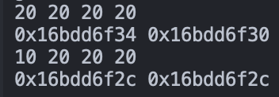
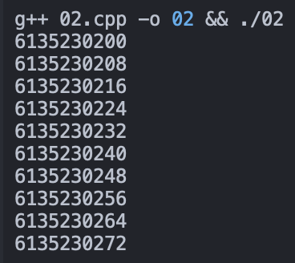
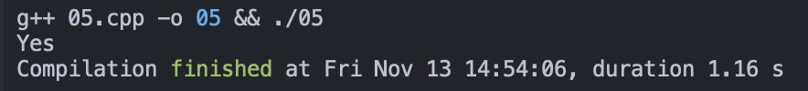
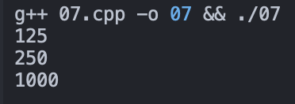
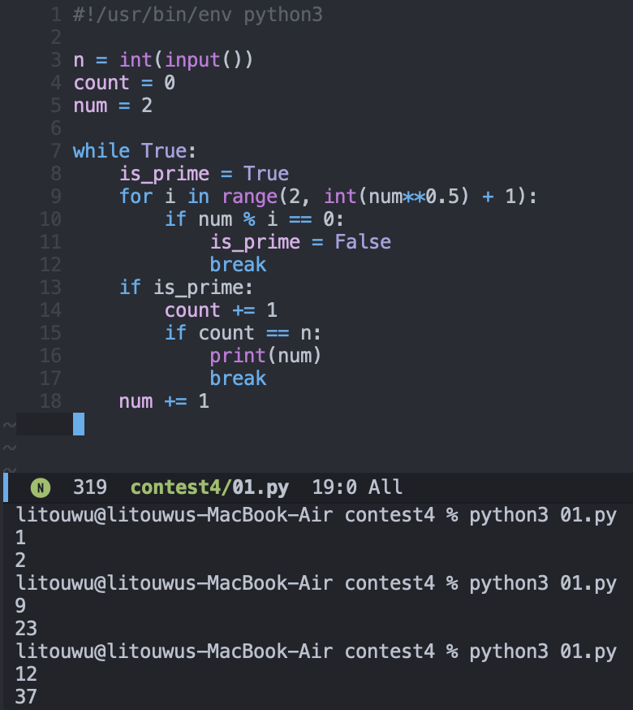
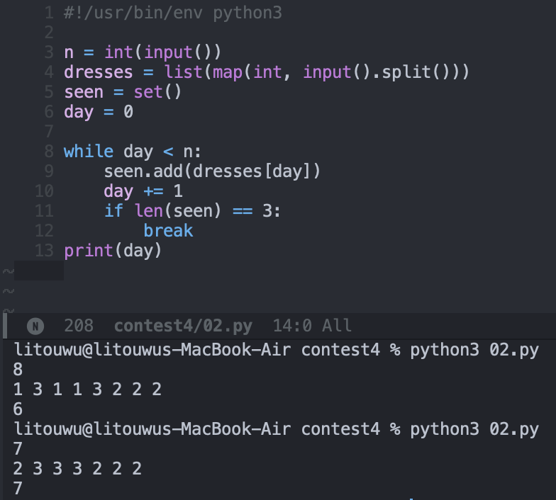
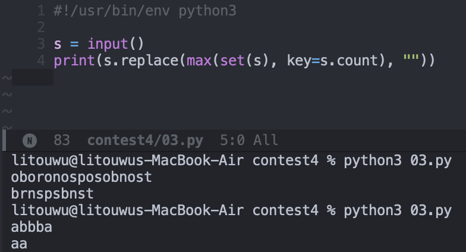
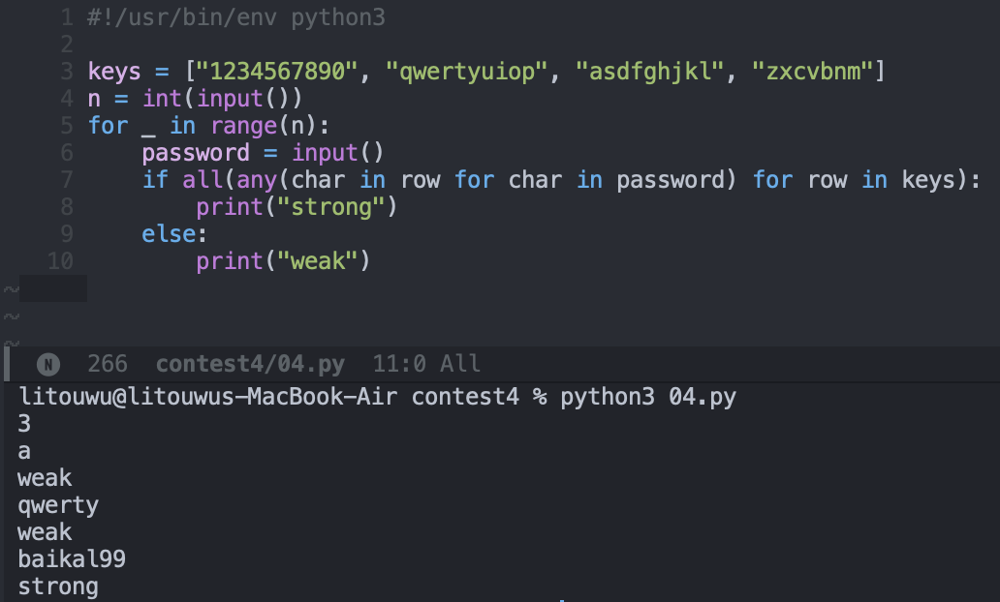
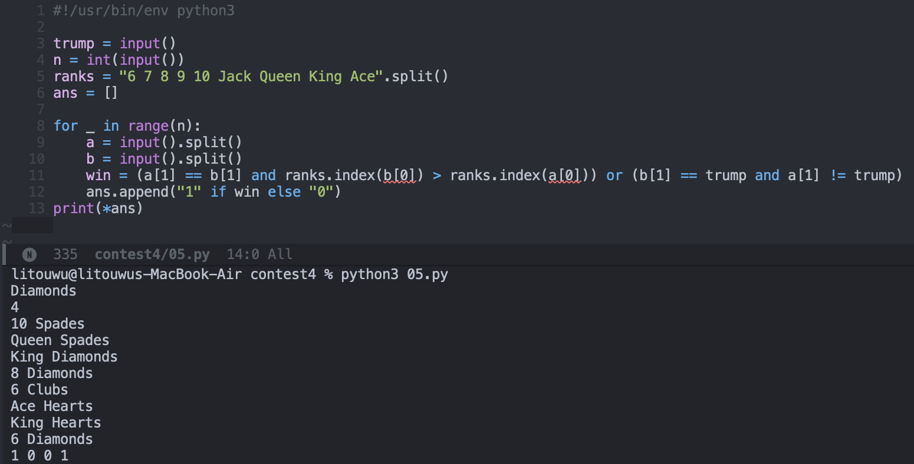

# Языки программирования
## Лабораторная работа 10

### Задание 1 **(2)**

*Рассмотрим следующие фрагменты программ.*
```
int a = 10, b = 20;
int *p = &a , *q = &b;
p = q
std::cout << *p <<' '<< *q << std::endl;
```
```
int a = 10, b = 20;
int *p = &a , *q = &b;
*p = *q
std::cout << *p <<' '<< *q << std::endl;
```
*Чем различаются присваивания в третьей строке? Что можно вывести,
чтобы показать различия?*

*Примеры программ сохраните в папке с номером задания.*

---
## Решение  

`*` - описатель указателя при объявлении переменной, умножение, оператор разыменования (в выражении, возвращает значение по адресу из указания).
& - описатель ссылки (при объявлении переменной), оператор взятия адреса (в выражении). В данном случае в указатель 'p' помещается адрес 'a'.
Адрес - идентификатор ячейки данных, некоторое число, которое является адресом в ячейке памяти.

Первое:
*p выведет 20, *q тоже 20, итого: 20 20

```
#include <iostream>

int main() {
    int a = 10, b = 20;
    int *p = &a, *q = &b;
    *p = *q;
    std::cout << a << ' ' << b << ' ' << *p << ' ' << *q << std::endl;
    std::cout << p << ' ' << q << std::endl;

    int c = 10, d = 20;
    int *r = &c, *s = &d;
    r = s;
    std::cout << c << ' ' << d << ' ' << *r << ' ' << *s << std::endl;
    std::cout << r << ' ' << s << std::endl;
}
```



---


### Задание 2 **(1)**

*Рассмотрим следующую программу.* 
```
double x[10];
for (int i = 0; i <1 0; i++)
    std::cout << &x[i] << std::endl;
```
*Что она выводит? Измените
вывод так, чтобы адреса выводились в десятичной системе счисления.
Объясните почему числа составляют арифметическую прогрессию с
определенным шагом.*

*Записанную программу сохраните в папке с номером задания.*

---
## Решение  

```
#include <iostream>

int main(){
	double x[10];
	for (int i = 0; i < 10; i++){
		std::cout << reinterpret_cast<size_t>(&x[i]) << std::endl;
	}
}
```


---

### Задание 3 **(2)**

*Токен* **«*»** *в языке C++ может использоваться в трех различных
случаях. Аналогично токен* **«&»** *также может использоваться в трех
случаях. Приведите пример одной программы в которой они были бы
использованы во всех случаях.*

*Записанную программу сохраните в папке с номером задания.*

---
## Решение  

```
#include <iostream>

int main() {
  int a = 5, b = 2;
  
    int mult = a * b;
    int* ptr = &a;
    *ptr = 10;

    int bitwise = a & b;
    int* p2 = &a;
    int& ref = a;
    ref = 20;

    std::cout << "a = " << a << ", b = " << b << std::endl;
    return 0;
}
```

---

### Задание 4 **(2)**

*Выпишите значения всех переменных, в том числе указателей,
после выполнения каждой инструкции программы. Объясните, что
происходит в результате выполнения каждой инструкции.*
```
unsigned a = 8, b = 3 ,c = 17;
unsigned *p = &a;
unsigned *q = &b;
*p += *q + c;
c = *q;
p = &c;
c += a;
*p += 10;
*q = *p;
q = p ;
*q += 10;
```

---
## Решение  

1. `unsigned a = 8, b = 3, c = 17;`
Объявляются три переменные и задает им значения
a = 8, b = 3, c = 17

2. `unsigned *p = &a;`
Указатель `p` хранит адрес переменной `a`
a = 8, b = 3, c = 17, p указывает на a

3. `unsigned *q = &b;`
Указатель `q` хранит адрес переменной `b`
a = 8, b = 3, c = 17, p указывает на a, q указывает на b

4. `*p += *q + c;`
`*p` это `a`, `*q` это `b`. Получается a = 8 + (3 + 17) = 28
a = 28, b = 3, c = 17, p на a, q на b

5. `c = *q;`
В `c` записывается значение, на которое указывает `q`, то есть значение `b`
a = 28, b = 3, c = 3, p на a, q на b

6. `p = &c;`
Меняется сам указатель теперь `p` хранит адрес `c`. Значения переменных не меняются
a = 28, b = 3, c = 3, p на c, q на b

7. `c += a;`
c = 3 + 28 = 31
a = 28, b = 3, c = 31, p на c, q на b

8. `*p += 10;`
`*p` это `c` значит c = 31 + 10 = 41
a = 28, b = 3, c = 41, p на c, q на b

9. `*q = *p;`
Значение на которое указывает `p` (это `c` = 41) записывается в `b`
a = 28, b = 41, c = 41, p на c, q на b

10. `q = p;`
Копируется адрес из `p` в `q`. Теперь оба указывают на `c`. Значения переменных не меняются
a = 28, b = 41, c = 41, p на c, q на c

11. `*q += 10;`
`*q` это `c`, значит c = 41 + 10 = 51
a = 28, b = 41, c = 51, p на c, q на c

---

### Задание 5 **(1)**

*Что сравнивается в приведенной ниже программе? Как можно
изменить первую строчку программы, чтобы результат тоже
изменился?*
```
int x = 1, y = 2;
int *p = &y, *q = &x;
if (p < q)
    std::cout << "Yes";
else
    std::cout << "No";
```

---
## Решение  

Сравниваются не значения, а адреса переменных, адрес p меньше чем адрес q = yes, меняем местами выдает no.
```
#include <iostream>

int main(){
	int y = 2, x = 1;
	int *p = &y, *q = &x;
	if (p < q)
    	std::cout << "Yes";
	else
    	std::cout << "No";
}
```



---

### Задание 6 **(2)**

*Объясните работу следующей программы. Как изменится
результат, если тип* **double** *изменить на некоторый другой, например*
**int** *или* **char**?
```
double x = 0;
double *d = &x;
std::cout << reinterpret_cast<size_t>(d + 4) - reinterpret_cast<size_t>(d - 4) << std::endl;
```

---
## Решение  


---

### Задание 7 **(2)**

*Объясните работу следующей программы. Как изменится
результат, если тип* **double** *изменить на некоторый другой, например*
**int** *или* **char**?
```
std::cout << reinterpret_cast <double*>(3000) - reinterpret_cast <double*>(2000) << std::endl;
```

---
## Решение

```
#include <iostream>

int main(){
	std::cout << reinterpret_cast <double*>(3000) - reinterpret_cast <double*>(2000) << std::endl;
	std::cout << reinterpret_cast <int*>(3000) - reinterpret_cast <int*>(2000) << std::endl;
	std::cout << reinterpret_cast <char*>(3000) - reinterpret_cast <char*>(2000) << std::endl;
}
```

3000 и 2000 превращаются в указатели типа double и вычитаются два указателя и разность адресов делится на размер типа, а при замене на int это 1000 на 4 = 250, на char = 1000, так как размер типа 1 байт.



---


### Задание 8 **(2)**

*Что надо дописать в записанной ниже программе вместо многоточий, чтобы
она выводила все числа из массива* **a**? *Почему?*
```
int a[20];
for ( int i = 0; i < 20; i++)
    a[i] = i;
int *b=a + 8;
for (int i =...; i <...; i++)
    std::cout << b[i] <<' ';
```
---
## Решение  

```
#include <iostream>

int main(){
	int a[20];
for (int i = 0; i < 20; i++){
    a[i] = i;
	}
int *b = a + 8;
for (int i = -8; i < 12; i++){
    std::cout << b[i] <<' ';
	}
}
```

Указатель b устанавливается на a[8] и при i = -8 получаем a[0], при i = 11 получаем a[19], то есть проходится весь массив a  

---

### Задание 9 **(2)**

*Что выводит следующая программа? Изменится ли результат если
изменить тип элементов массива?*

```
int a[10];
std::cout << &a[8] - &a[3] << std::endl;
```

---
## Решение  

Выводит разность между 8 и 3 элементами, независит от типа, т.е. при изменении не меняется

---

### Задание 10 **(1)**

*Есть ли разница между инициализацией* **p** и **q** *в следующей программе? Обоснуйте ответ.*
```
int x [10]={1, 2, 3, 4, 5, 6, 7, 8, 9, 10};
int *p = x + 5;
int *q = &x[5];
```

---
## Решение  

Нет разницы, одинаковый адрес - так как `x + 5` адрес элемента с индексом 5 (т.к. имя указателя преобразуется в указатель на первый элемент и смещается на пять элементов), `&x[5]` - тот же элемент взятый непосредственно

---

### Задание 11 **(3)**

*Указатели можно использовать для итерации по массивам.
Напишите программу, которая найдет сумму элементов массива,
используя указатели. В начале цикла указатель требуется установить
на начало массива, в конце каждой итерации смещать его к
следующему элементу массива через инкремент. Для выхода из цикла
надо проверять, что указатель дошел до конца массива.*
```
int x [10]={1, 2, 3, 4, 5, 6, 7, 8, 9, 10};
int s = 0;
for (int *p = ...; ...; ...)
    s += ...
std::cout << s;
```

---
## Решение  

```
#include <iostream>

int main(){
	int x [10]={1, 2, 3, 4, 5, 6, 7, 8, 9, 10};
	int s = 0;
	for (int *p = x; p < x + 10; p++)
		s += *p;
	std::cout << s;
}
```

---


## Задачи с контеста 4  

### Задача 1  



### Задача 2  



### Задача 3  



### Задача 4  



### Задача 5  


