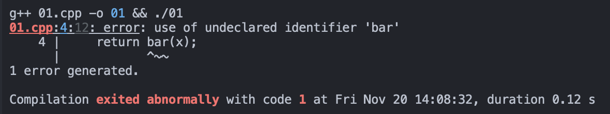
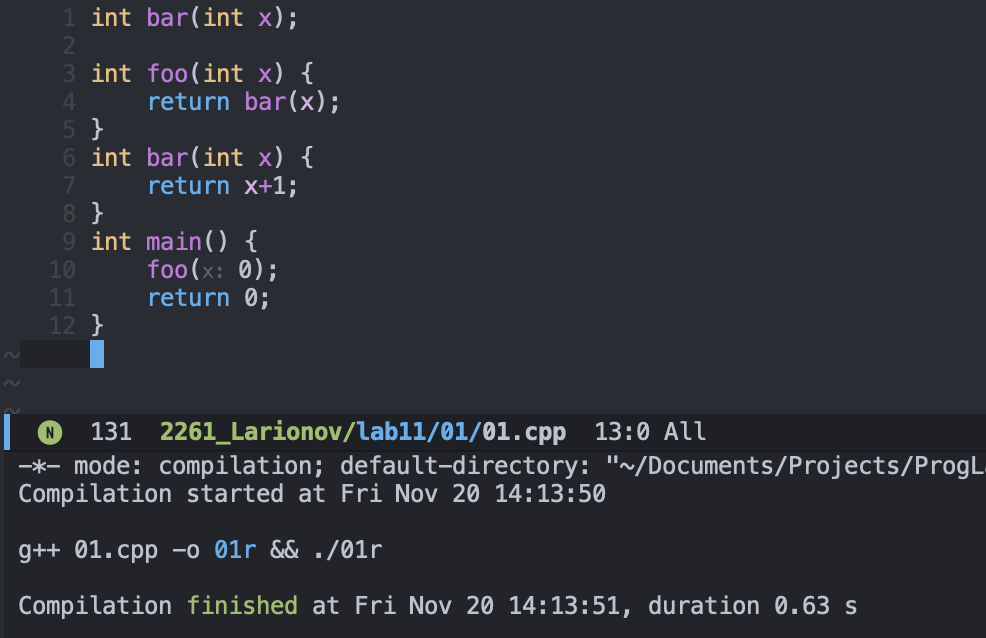
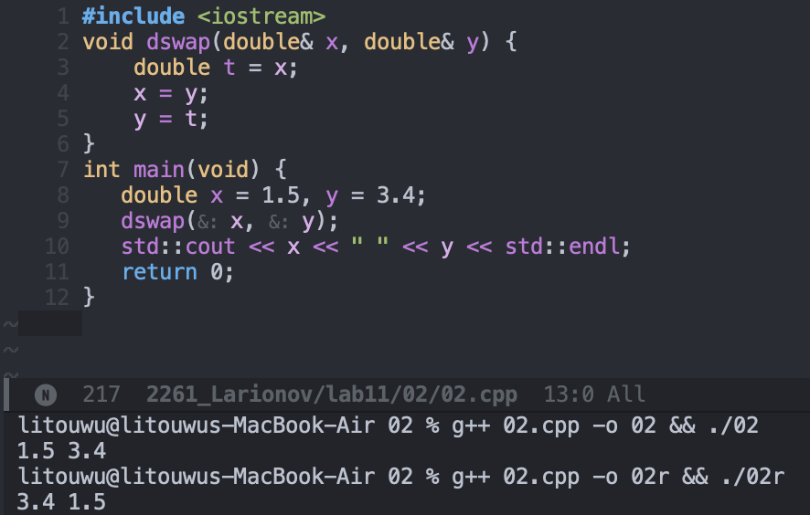
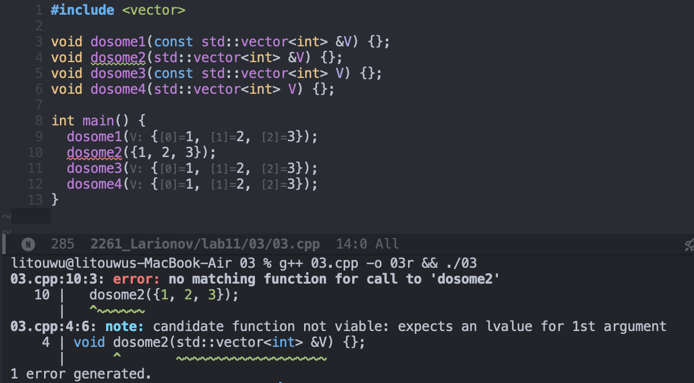
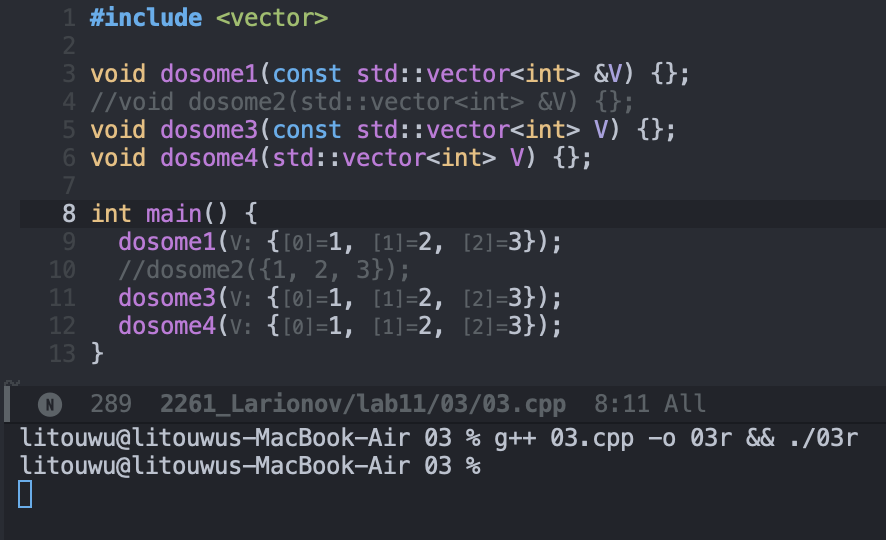

# Языки программирования
## Лабораторная работа 11

### Задание 1 **(2)**

*Что надо дописать в приведенный пример программы, чтобы она транслировалась без ошибок?
Существующий код нельзя изменять или переставлять.*

```
int foo(int x) {
    return bar(x);
}
int bar(int x) {
    return x+1;
}
int main() {
    foo(0);
    return 0;
}
```

---
## Решение  



Нужно объявить функцию и тогда исправно работает  



---

### Задание 2 **(1)**

*Функция* **dswap** *должна была обменивать значения своих параметров.* 
*(На выводе должно было получиться* ```3.4 1.5```.)
*В чем ошибка при написании этой функции? Как ее исправить? 
Что передавалось в параметры у исходной функции и у исправленной?* 
```
#include <iostream>
void dswap(double x, double y) {
   double t = x;
   x = y;
   y = t;
}
int main(void) {
   double x = 1.5, y = 3.4;
   dswap(x, y);
   std::cout << x << " " << y << std::endl;
   return 0;
}
```

---
## Решение  

Ошибка была в передаче аргументов в функцию `dswap` по значению, а не по ссылке, чтобы передать по ссылке, надо `&` написать перед именами переменных



---

### Задание 3 **(3)**

*Известно, что функция* **dosome** *не изменяет значений вектора* **V**.
*Какие из способов объявления функции является правильным с точки зрения 
корректности работы программы? В чем разница между этими способами?*


```
void dosome(const vector<int> &V);
void dosome(vector<int> &V);
void dosome(const vector<int> V);
void dosome(vector<int> V);
```

*Проверьте в какие из этих функций можно передать константные вектора. ОЛбъясните результат.*
```
dosome({1, 2, 3});
```

---
## Решение  

Можно передавать в первую, третью, четвертую функцию. Нельзя передовать во вторую функцию так как вызываем изменяющую ссылку на неизменяемый объект и компилятор выдает ошибку  

С точки зрения корректности работы программы самый верный первый способ, так как вектор не копируется, второй менее верен так как может потенциально изменить вектор, третий менее верен так как копирует вектор в функцию, четвертый менее верен так как копируется вектор  





---

### Задание 4 **(2)**

*Напишите программу в которой будет создаваться восемь массивов из 128 целых чисел четырьмя способами,
каждым способом по два массива.
Первые два массива должны быть глобальными, вторые — локальными статическими, третьи — локальными на стеке,
четвертые — локальными в куче. Выведите адреса первого и последнего элемента в каждом массиве.
Сравните, насколько далеко они располагаются друг от друга. Какие выводы можно из этого сделать.*

*В отчет запишите программу и скриншот ее работы.*

### Задание 5 **(2)**

*Приведенная ниже программа вызывает ошибку. Почему?*

*Что будет, если перенести объявление массива выше функции* **foo**?

*Что будет, если объявить массив с использованием ключевого слова* **static**?

*Что будет, если создать массив такого же размера с использованием* **new**?
```
#include <iostream>
int foo() {
    int x[100010001];
    return x[100010000];
}
int main() {
    std::cout << foo();
    return 0;
}
```


### Задание 6 **(3)**

*Запишите следующую программу. Выполните ее трансляцию с нулевым оровнем оптимизации.
Нарисуйте схематично расположение переменных в памяти в момент вызова при \verb*|a=0|. 
Отметьте кадры стека.*

```
#include <iostream>
long long foo(long long a, long long b) {
   if (a == 0) 
      return 0;
   else {
      long long x, y;
      std::cout << "Enter a=" << a << ", b=" << b << std::endl;
      std::cout << "Ptrs " << &a << ' ' << &b <<' '<< &x<<' '<<&y << std::endl;
      x = a * b;
      y = foo(a - 1, b + 1);
      return x + y;
   }
}
int main() {
   foo(5, 5);
   return 0;
}
```

### Задание 7 **(3)**

*Рассмотрите следующую программу. Выполните ее трансляцию, используя  компилятор g++ без
оптимизации (уровень оптимизации 0). Объясните ее работу.*
```
#include <iostream>
double &choose(double &a, bool flg) {
    double pi = 3.14;
    double &r = flg ? pi : a;
    return r;
}

int main(void)
{
    double a = 2.7;
    double &pi = choose(a, true);
    std::cout << pi << std::endl;
    double &e = choose(a, false);
    std::cout << e << std::endl;
    std::cout << pi << std::endl;
    return 0;
}
```

### Задание 8 **(3)**

*Объясните работу приведенной ниже программы.
Какие ошибки в ней имеются? (Виды ошибок смотрите в лекции.)*
```
#include <iostream>
int main() {
    int *p = new int [10];
    int *q = new int [10];
    for (int i = 0; i <= 10; i++)
        p[i] = i;
    q = p;
    delete[] p;
    for (int i = 0; i <= 10; i++)
        std::cout << q[i] <<" ";
    delete[] q;
    return 0;
}
```

## Контест 5  

### Задача 1  

```
n, m = map(int, input().split())
a = list(map(float, input().split()))
for _ in range(m):
    b = [0.0] * n
    b[0] = (2 * a[0] + a[1]) / 3
    b[n - 1] = (2 * a[n - 1] + a[n - 2]) / 3
    for i in range(1, n - 1):
        b[i] = (a[i - 1] + a[i] + a[i + 1]) / 3
    a = b
print(*a)
```

### Задача 2

```
n = int(input())
a = list(map(int, input().split()))
a.sort(key=lambda x: abs(x) * 2 + (x > 0))
print(*a)
```

### Задача 3

```
word = input()
n = int(input())
d = {}
for _ in range(n):
    key = input()
    d[key] = input()
for i in range(1, len(word)):
    left = word[:i]
    right = word[i:]
    if left in d and right in d:
        print(d[left] + d[right])
        break
```

### Задача 4

```
n, m = map(int, input().split())
a = []
for _ in range(n):
    a.append(list(map(int, input().split())))
for j in range(m):
    row = []
    for i in range(n):
        row.append(a[i][j])
    print(*row)
```

### Задача 5

```
import sys
from math import sqrt

data = sys.stdin.read().split()
w, h, s = int(data[0]), int(data[1]), int(data[2])
n = int(data[3])

trees = []
for i in range(n):
    x = int(data[4 + 2 * i])
    y = int(data[5 + 2 * i])
    k = x // s
    if k % 2 == 0:
        trees.append((k, y, x))
    else:
        trees.append((k, -y, x))
trees.sort()

total = 0.0
px, py = trees[0][2], abs(trees[0][1])
for k, y, x in trees[1:]:
    y = abs(y)
    total += sqrt((x - px) ** 2 + (y - py) ** 2)
    px, py = x, y

print(total)
```
