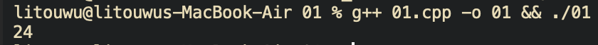
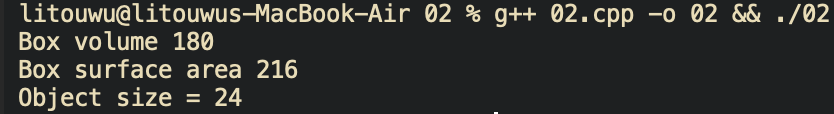
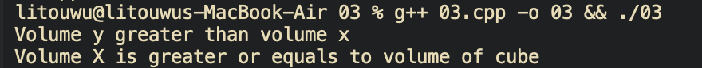

# Языки программирования
## Лабораторная работа 12

**Первые шесть заданий требуется выполнить на языке С++.**
### Задание 1 **(2)**

*Запишите класс* **box** *с тремя скрытыми полями типа с плавающей
точкой:* **length**, **widht**, **height**. *Добавьте в класс инициализирующий
конструктор. Найдите размер одного объекта этого класса с
использованием* **sizeof**.

---

## Решение  

```
#include <iostream>

class box {
private:
	double lenght;
	double width;
	double height;

public:
	box(double _lenght, double _width, double _height):
		lenght(_lenght), width(_width), height(_height){

		}
};

int main(){
	box b(10, 6, 3);
	std::cout << sizeof(b) << std::endl;
}

```

  

Вывод 24, т.к. размер объекта равен сумме размеров его полей (8 байт по три раза - 24 байта)

---

### Задание 2 **(2)**

*Добавьте в класс методы для вычисления объема коробки и
площади поверхности всех граней. Напишите программу, тестирующую
работу методов. Проверьте, изменился ли размер одного объекта этого
класса. Объясните результат*

---

## Решение  

```
#include <iostream>

class box {
private:
	double lenght;
	double width;
	double height;


public:
	box(double _lenght, double _width, double _height):
		lenght(_lenght), width(_width), height(_height){

		}
	double volume();
	double surface();
};

double box::volume(){
	return lenght * width * height;
}

double box::surface(){
	return 2 * (lenght * width + lenght * height + width * height);
}

int main(){
	box b(10, 6, 3);
	std::cout << "Box volume " << b.volume() << std::endl;
	std::cout << "Box surface area " << b.surface() << std::endl;
	std::cout << "Object size = " << sizeof(b) << std::endl;
}
```

  

Выводы класса в самом классе не хранятся  

---


### Задание 3 **(2)**

*Создайте два объекта* **x** *и* **y** *класса* **box** *в куче. Напишите
программу, для проверки работы методов, которая будет использовать
оба объекта. Не забывайте, что объекты созданные в куче следует
освобождать.*

---

## Решение  

```
#include <iostream>

class box {
private:
	double lenght;
	double width;
	double height;

public:
	box(double _lenght, double _width, double _height):
		lenght(_lenght), width(_width), height(_height){

		}
    double volume() const {
        return lenght * width * height;
    }
};


int main() {

    box *x = new box(10, 6, 3);
    box *y = new box(8, 8, 8);
    if (y->volume() > x->volume()) {

        std::cout << "Volume y greater than volume x" << std::endl;
    } else {

        std::cout << "Volume x greater than volume y" << std::endl;
    }

    box *cube = new box(5, 5, 5);
    if (cube->volume() > x->volume()) {
        std::cout << "Cube volume is greater than volume X" << std::endl;
    } else {
        std::cout << "Volume X is greater or equals to volume of cube" << std::endl;
    }
    delete x;
    delete y;
    delete cube;
    return 0;
}
```

  

---

### Задание 4 **(2)**

*Добавьте в класс одно статическое поле и метод для вывода
адресов всех четырех полей. Создайте три объекта этого класса в
куче, в статической памяти и на стеке. Выведите адреса полей.
Объясните результат.*

---

## Решение  

```
#include <iostream>

class box {
private:
	double lenght;
	double width;
    double height;
    static int objectCount;

public:
	box(double _lenght, double _width, double _height):
		lenght(_lenght), width(_width), height(_height){
        objectCount++;
    }
    ~box() {
        objectCount--;
    }
    double volume() const {
        return lenght * width * height;
    }
    void addr() const {
      std::cout << "address of lenght " << &lenght << "\n";
      std::cout << "address of width " << &width << "\n";
      std::cout << "address of height " << &height << "\n";
      std::cout << "address of static field objectCount " << &lenght << "\n";
    }
};

int box::objectCount = 0;

box c(7, 8, 9);

int main(){
	box a (1, 2, 3);
	box	*b = new box(4, 5, 6);

	a.addr();
	b->addr();
	c.addr();

    delete b;
    return 0;
}

```

---

### Задание 5 **(2)**

*Напишите программу, которая продемонстрирует разницу между
присваиванием* ```x=y``` *и* ```*x=*y```.

### Задание 6 **(3)**

*Запишите класс* **rational** *(рациональное число, представленное в
виде дроби).*
```
class rational {
private :
    long long nom;
    unsigned long long denom;
};
```
*Добавьте в класс конструкторы так, чтобы:*

* *по умолчанию дробь инициализировалась как* ```0/1```;
* *работала инициализация* ```rational r = 3;```
* *работала инициализация* ```rational r(-2, 3);```
* *работала инициализация* ```rational t = r;```

### Задание 7 **(2)**

*Напишите программу на Python в которой будет определяться
класс* **Point** *с двумя полями* **x** *и* **y**. *Класс должен содержать
конструктор и метод* **__str__** *для создания текстового представления
точки. 

Напишите программу для проверки работы методов.*

---

## Решение  

```
class Point:
    def __init__(self, x, y):
        self.x = x
        self.y = y

    def __str__(self):
        return '(' + str(self.x) + ', ' + str(self.y) + ')'

a = Point(10, 5)
print(a)
```

---

### Задание 8 **(2)**

*Напишите программу на Python в которой будет определяться класс*
**Rectangle** *с двумя полями типа* **Point**. *Точки задают левый верхний
и правый нижний угол прямоугольника. Класс должен содержать
конструктор и метод* **__str__** *для создания текстового представления
прямоугольника. 

Напишите программу для проверки работы методов.*

---

## Решение  

```
class Point:
    def __init__(self, x, y):
        self.x = x
        self.y = y
    def __str__(self):
        return '(' + str(self.x) + ', ' + str(self.y) + ')'

class Rectangle:
    def __init__(self, a, b):
        self.topleft = a
        self.bottomright = b
    def __str__(self):
        return '|' + str(self.topleft) + '-' + str(self.bottomright) + '|'

a = Point(10, 5)
print(a)
r = Rectangle(Point(0, 10), Point(10, 0))
print(r)

Rectangle.square = lambda self : abs((self.topleft.x - self.bottomright.x) * \
                    (self.topleft.y - self.bottomright.y))

print(r.square())
```

---


### Задание 9 **(2)**

*Добавьте в класс функцию для вычисления площади
прямоугольника. Функцию следует добавить не в момент
определения класса, а в процессе работы программы.*

*Проверьте работоспособность функции.*

### Задание 10 **(2)**

*Добавьте в программу класс* **Segment** *с двумя полями типа*
**Point**. *Точки задают концы отрезка. Класс должен содержать
конструктор, метод* **__str__** *для создания текстового представления
отрезка и метод* **length** *для нахождения длины отрезка.*

*Напишите программу для проверки работы методов.*

*Измените тип ранее созданного объекта класса* **Rectangle** *на* **Segment**.
*Объект должен создаваться с типом* **Rectangle**, *а после изменить тип
на* **Segment**.

*Проверьте работу методов до и после изменения типа.*
